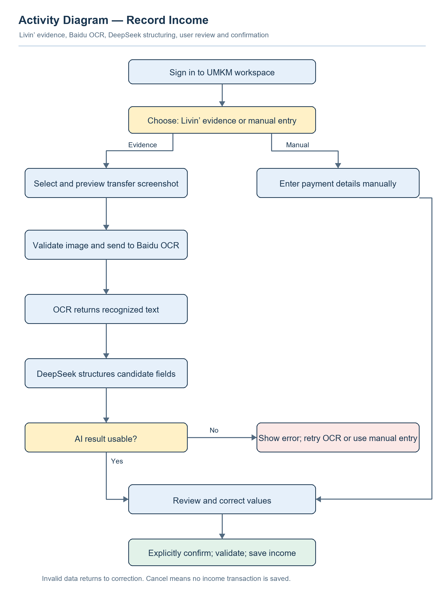

# RekapTF

RekapTF membantu UMKM mencatat pemasukan dari bukti transfer Livin’ by Mandiri dan melihat rekap per periode. Pengembangan dilakukan bertahap sesuai [log kerja](log-kerja.md).

Repo ini memuat **pengumpulan Sprint 1**. Riwayat dibuat khusus untuk Sprint 1 (15 commit, tip `43b4258`) dan dipush ke `main` pada `https://github.com/Kysohee18/0046_RekapTF.git`; hash tip dicocokkan dengan `git ls-remote origin refs/heads/main`. Pekerjaan Sprint 2 dan 3 masih berada di folder pengembangan dan belum dikumpulkan.

## Progres sprint

| Sprint | Fitur | Status | Bukti |
|---|---|---|---|
| 1 | Setup Awal Proyek | ✅ Commit `8933723` | Scaffold Compose, katalog versi, Gradle Wrapper, dan diagram aktivitas. Kompilasi modul lulus di folder pengembangan; build APK dijalankan pengguna. |
| 1 | Debug USB dan navigasi | ✅ Commit `1211596`, `2538f13`, `f3cfc94` | Aturan jaringan debug, skrip pemeriksaan USB, serta empat tab dengan state yang dipulihkan. Uji APK di perangkat menyusul. |
| 1 | Akun UMKM | ✅ Commit `16e2e91`, `9d95268` | API daftar, masuk, rotasi refresh, keluar, dan profil diuji lokal pada penyimpanan memori; layar Masuk dan Daftar mengikuti PRD desain. |
| 1 | Kategori pemasukan dan pengirim | ✅ Commit `cab0366`, `1d00045`, `368b44c` | CRUDS dan pencarian nama, dengan uji isolasi akun serta penolakan lintas akun. |
| 1 | Transaksi pemasukan | ✅ Commit `05c8870`, `9f613ab` | Klien REST, daftar bertanggal, detail, editor, dan hapus. Uji transaksi dari APK belum dicatat. |
| 1 | Beranda ringkasan bulanan | ✅ Commit `d5e26f3` | Kartu total, komposisi kategori, dan pemasukan terbaru. Angka pada APK belum diperiksa. |
| 1 | UI sesuai PRD desain v1.0 | ✅ Commit `ddba0e6` | Token warna, tipografi, bentuk, serta komponen dasar. Uji TalkBack dan perangkat belum. |
| 2 | Draf OCR dan staging | ☐ Belum dikumpulkan | Kerangka kode ada pada `43b4258` dan belum dievaluasi. |
| 3 | Rekap, berkas lokal, dan demo | ☐ Belum dikumpulkan | Kerangka kode ada pada `43b4258` dan belum dievaluasi. |
| 4 | Pengumpulan fitur terpilih | ☐ Direncanakan | Cakupan ditetapkan setelah hasil sprint sebelumnya. |

Berkas `43b4258` disertakan hanya agar modul data dan navigasi tetap dapat dikompilasi; isinya milik Sprint 2 dan 3 sehingga tidak dihitung sebagai capaian Sprint 1.

## Alur aplikasi



Sumber diagram adalah SRS RekapTF v0.4 di folder pengembangan.

## Pengembangan

Jalankan API lokal dari root proyek dengan Go 1.26:

```powershell
Set-Location backend
go run .
```

API mendengarkan di `127.0.0.1:8080` dalam mode demo. Gunakan data sintetis. Akun, kategori, dan pengirim dalam penyimpanan memori hilang saat API berhenti. [Kontrak API dan opsi PostgreSQL lokal](backend/README.md)

### Uji APK Sprint 1

1. Buka root pengembangan di Android Studio dengan SDK Platform 37. Pengguna menjalankan Gradle Sync dan build Android; build APK tidak dijalankan oleh agent.
2. Untuk **Run dari Android Studio ke HP lewat USB**, buat `rekap-debug.local.properties` di root proyek dengan isi `rekapDebugApiBaseUrl=http://127.0.0.1:8080`, lalu jalankan Run pada varian `debug`. Berkas ini diabaikan Git. Saat kembali memakai emulator, kosongkan nilai atau hapus berkas agar debug kembali ke `http://10.0.2.2:8080`.

   Untuk build dari terminal, `-PrekapApiBaseUrl` diprioritaskan di atas konfigurasi lokal:

   ```powershell
   .\gradlew.bat :app:assembleDebug "-PrekapApiBaseUrl=http://127.0.0.1:8080"
   ```

   Jalankan [skrip debug USB](scripts/prepare-usb-debug.ps1) dari root saat APK dan perangkat siap. Skrip memeriksa kesehatan API lokal dan pemetaan port ADB.
3. Daftar akun sintetis A dan periksa pesan saat konfirmasi kata sandi berbeda. Tambah kategori dan pengirim penanda A, catat satu transaksi pemasukan, lalu buka detail serta edit nilainya. Keluar, buat akun sintetis B dengan penandanya sendiri, dan pastikan setiap akun hanya melihat data miliknya.
4. Uji cari dan filter pada daftar kategori serta pelanggan, lalu coba hapus kategori atau pengirim yang masih dipakai transaksi: penghapusan harus ditolak dengan pesan yang jelas.
5. Putar perangkat pada layar Beranda, daftar transaksi, dan formulir; state isian dan posisi daftar harus bertahan. Jalankan TalkBack pada tombol utama dan pastikan setiap aksi terbaca dari labelnya.

### Rencana uji Sprint 2 dan 3

Belum termasuk pengumpulan ini. Skenarionya tetap dicatat agar tidak hilang:

1. Pilih gambar bukti sintetis dari folder pengembangan (`docs/fixtures/`), baca pemberitahuan pemrosesan, lalu buat draf. Gambar belum disertakan di repo agar pengumpulan hanya memuat berkas Sprint 1.
2. Periksa rekap rentang tanggal draf sebelum konfirmasi, lalu pastikan konfirmasi hanya menambah satu transaksi. Uji penolakan hapus transaksi yang masih merujuk kategori atau pengirim.
3. Coba rekap harian, mingguan, bulanan, dan rentang pilihan; simpan filter bernama, lalu buka dan hapus filter tersebut.
4. Putar perangkat saat pemilih tujuan snapshot JSON terbuka, lanjutkan penyimpanan, lalu buka berkas dan cocokkan isi serta totalnya dengan rekap saat ekspor dimulai.
5. Catat varian dan ukuran APK, perangkat, waktu OCR lokal, waktu hingga draf, puncak memori, serta ketepatan nominal dan tanggal di [log kerja](log-kerja.md).
